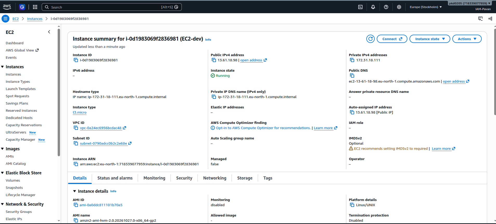
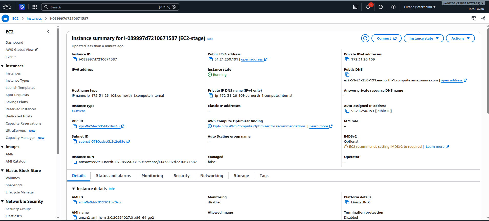

# Terraform AWS EC2 — Workspace Management

Provision and manage separate AWS EC2 instances for **Development (`dev`)** and **Staging (`stage`)** environments using Terraform Workspaces.

This project demonstrates how Terraform Workspaces help manage multiple environments using a single Terraform configuration while maintaining separate state files.

## 📌 Project Overview

The objective of this project is to understand Terraform Workspace management and use it to provision EC2 instances for different environments.

### Key Features

- Infrastructure as Code (IaC) using Terraform
- AWS EC2 instance provisioning
- Separate `dev` and `stage` workspaces
- Independent Terraform state for each workspace
- Reusable Terraform configuration
- Variable and output management
- Environment-specific infrastructure management

## 🏗️ Project Architecture

```text
Terraform Configuration
          |
          v
   Terraform Workspace
       /        \
      v          v
    dev         stage
      |           |
      v           v
  AWS EC2      AWS EC2
  Instance     Instance
      |           |
      v           v
  dev state   stage state
```

## 📂 Project Structure

```text
.
├── main.tf
├── Output-Images
│   ├── Output-EC2-dev.png
│   └── Output-EC2-stage.png
├── outputs.tf
├── terraform.tfstate.d
│   ├── dev
│   │   └── terraform.tfstate
│   └── stage
│       └── terraform.tfstate
└── variable.tf
```

| File / Directory | Description |
|---|---|
| `main.tf` | Defines the AWS infrastructure resources. |
| `variable.tf` | Declares input variables used by the configuration. |
| `outputs.tf` | Defines output values, such as EC2 instance details, if configured. |
| `terraform.tfstate.d/` | Contains local state directories for non-default workspaces. |
| `terraform.tfstate.d/dev/` | Stores the local state for the `dev` workspace. |
| `terraform.tfstate.d/stage/` | Stores the local state for the `stage` workspace. |
| `Output-Images/` | Contains screenshots of the provisioned EC2 instances. |

**Note:** The state-file paths shown above represent Terraform's typical local state layout for named workspaces. State files should not be committed to a public repository.

## 🧠 What Is a Terraform Workspace?

A Terraform Workspace is a way to maintain multiple state instances for the same Terraform configuration.

For example:

- **dev:** Used to provision infrastructure for development and testing.
- **stage:** Used to provision infrastructure for staging and pre-production testing.

Both workspaces can use the same `.tf` files, but each workspace maintains its own state.

### Why Use Workspaces?

- Manage multiple environments with one configuration.
- Keep environment state separate.
- Reduce configuration duplication for similar environments.
- Switch between environments using Terraform commands.

> Workspaces separate Terraform state, not AWS accounts or access permissions. Use appropriate IAM permissions and resource naming for each environment.

## 🛠️ Prerequisites

Before running this project, make sure you have:

- An AWS account with appropriate EC2 permissions
- AWS CLI installed and configured
- Terraform installed
- AWS credentials configured securely

Verify the installations:

```bash
terraform -version
aws --version
aws sts get-caller-identity
```

Configure AWS credentials using an appropriate method, such as an AWS CLI profile or environment variables. Avoid hardcoding access keys in Terraform files.

## 🚀 Getting Started

### 1. Clone the Repository

```bash
git clone <YOUR-REPOSITORY-URL>
cd <YOUR-PROJECT-DIRECTORY>
```

Replace the placeholders with your repository URL and project directory.

### 2. Initialize Terraform

```bash
terraform init
```

This initializes the working directory and downloads the required providers.

### 3. Validate the Configuration

```bash
terraform validate
```

### 4. Preview the Infrastructure

```bash
terraform plan
```

Review the proposed changes before applying them.

## 🌍 Workspace Management

### 5. List Available Workspaces

```bash
terraform workspace list
```

This displays the available workspaces. The currently selected workspace is marked with an asterisk (`*`).

### 6. Create the Development Workspace

```bash
terraform workspace new dev
```

If the workspace already exists, switch to it instead:

```bash
terraform workspace select dev
```

### 7. Deploy the Development EC2 Instance

```bash
terraform plan
terraform apply
```

Review the plan and confirm the apply operation when prompted.

### 8. Create or Select the Staging Workspace

Create the workspace if it does not exist:

```bash
terraform workspace new stage
```

Otherwise, select it:

```bash
terraform workspace select stage
```

### 9. Deploy the Staging EC2 Instance

```bash
terraform plan
terraform apply
```

Review the proposed changes before confirming.

**Important:** The configuration must use appropriate variables or workspace-aware logic if the two environments require different settings, such as instance names or instance types. Workspaces alone do not automatically create different configurations.

## 🔍 Verify the Active Workspace

Check the current workspace:

```bash
terraform workspace show
```

List all workspaces:

```bash
terraform workspace list
```

Switch between environments:

```bash
terraform workspace select dev
```

```bash
terraform workspace select stage
```

## 📸 Deployment Results

### Development Environment

The following screenshot shows the EC2 instance created for the development workspace.



### Staging Environment

The following screenshot shows the EC2 instance created for the staging workspace.



## 🧹 Cleanup

**Warning:** Destroying infrastructure can permanently remove resources. Confirm the active workspace before running the command.

To destroy the development environment:

```bash
terraform workspace select dev
terraform plan -destroy
terraform destroy
```

To destroy the staging environment:

```bash
terraform workspace select stage
terraform plan -destroy
terraform destroy
```

Review the proposed destruction and confirm when prompted.

Destroying resources does not delete the workspace itself. Also, avoid deleting state files manually while resources are still managed by Terraform.

## 🔐 Security Best Practices

- Never commit AWS credentials or private keys.
- Do not commit `terraform.tfstate` or `terraform.tfstate.d/`.
- Keep state files in secure storage with restricted access.
- Use a remote backend with locking where appropriate for team environments.
- Review `terraform plan` before applying or destroying resources.
- Apply least-privilege IAM permissions.
- Use suitable resource tags and names to identify environments.
- Remember that Terraform Workspaces are not a security boundary.

## 🎯 Learning Outcomes

By completing this project, you can practice:

- Provisioning AWS EC2 instances with Terraform
- Initializing and validating Terraform configurations
- Creating and switching between workspaces
- Managing separate state for development and staging
- Reviewing infrastructure plans and applying changes
- Safely managing infrastructure lifecycle operations

## 👨‍💻 Author

**Pavan Kumar Dixit**

RHCSA & RHCE Certified | Cloud & DevOps Enthusiast

Focus Areas: Linux, AWS, Terraform, Docker, Kubernetes, Jenkins, CI/CD, Prometheus and Grafana.

---

⭐ If you find this project useful, consider giving the repository a star.
